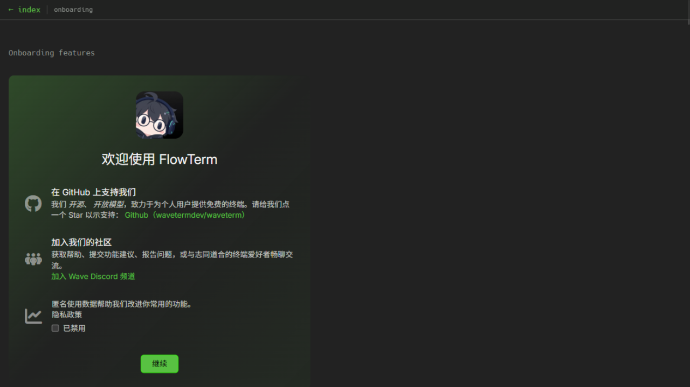

<p align="center">
  <a href="https://github.com/bintang1996/flowterm">
    
  </a>
  <br/>
</p>

<h1 align="center">FlowTerm</h1>

<div align="center">

基于 [Wave Terminal](https://github.com/wavetermdev/waveterm) 的二次开发分支 · Apache-2.0 · 简体中文 / [English](https://github.com/wavetermdev/waveterm#readme)

[](LICENSE)
[](README.md)
[](https://github.com/wavetermdev/waveterm)

</div>

---

**FlowTerm** 是一个开源的、集成 AI 能力的跨平台终端，基于 [Wave Terminal](https://github.com/wavetermdev/waveterm) 二次开发而来。所有上游许可声明均保留在 [LICENSE](LICENSE) 与 [NOTICE](NOTICE) 中。

FlowTerm 在 Wave 的基础上聚焦中文用户体验与轻量化定制：内置简体中文/English 双语界面、统一的框架内确认交互、更符合中文用户的品牌与默认配置，并移除了与上游云服务绑定的入口。



## ✨ 主要特性

继承自 Wave Terminal 的全部能力：

- **强大的分屏终端** —— 灵活的拖拽布局，自由组织终端、编辑器与预览块
- **持久化 SSH 会话** —— 断网、重启自动重连，远程会话永不丢失
- **远程文件管理** —— 内置图形化编辑器与在线预览（Markdown / 图片 / CSV / 目录）
- **`wsh` 命令系统** —— 在终端与会话之间共享数据、管理工作区
- **任意 AI 模型** —— BYOK 支持自定义 API Key，兼容 OpenAI / Claude / Gemini / Ollama

FlowTerm 的二次开发增强：

- 🌐 **简体中文 / English 双语界面** —— `app:language` 一键切换，缺失文案自动回落英文
- 🔔 **统一的框架内确认交互** —— 关闭标签页、删除工作区、关闭窗口均使用与应用风格一致的确认弹窗
- 🖼️ **个性化工作区图标** —— 支持项目 SVG 图标（默认 `layers-fill`），跟随工作区颜色渲染
- 🧹 **更纯净的默认配置** —— 精简上游云服务入口，开箱即用

## 📦 安装与构建

```sh
# 依赖：Node 22 LTS / Go / Task (go-task) / Zig
task init                 # 安装依赖
task electron:winquickdev # Windows 开发模式（带热更新）
task package              # 打包安装程序（产物在 make/）
```

完整的依赖清单、图标资源替换与二次开发扩展指南见 [DEVELOPMENT.md](DEVELOPMENT.md)。

## 🗺️ Roadmap

FlowTerm 处于活跃开发阶段。功能建议与问题反馈欢迎提 Issue。

## 🙏 致谢

FlowTerm 站在巨人的肩膀上——感谢 [Wave Terminal](https://github.com/wavetermdev/waveterm) 与 [Command Line Inc](https://www.commandline.dev/) 的杰出工作，以及上游的全部[贡献者](https://github.com/wavetermdev/waveterm/graphs/contributors)。

上游文档：[docs.waveterm.dev](https://docs.waveterm.dev) · 上游社区：[Discord](https://discord.gg/XfvZ334gwU)

## 📄 许可证

[Apache-2.0](LICENSE) © Command Line Inc · FlowTerm 二次开发部分遵循同一协议
